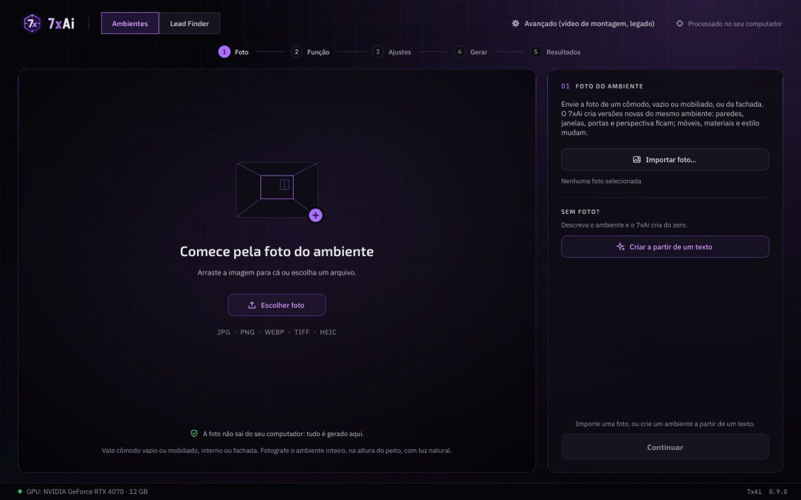
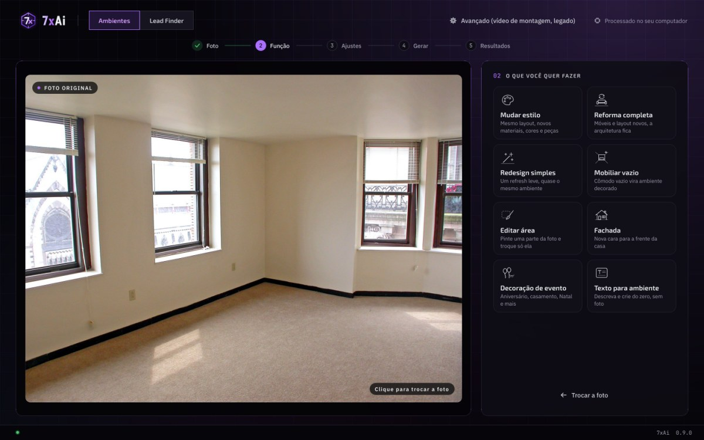
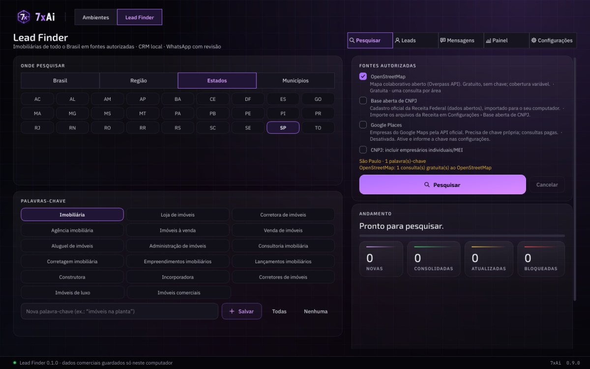
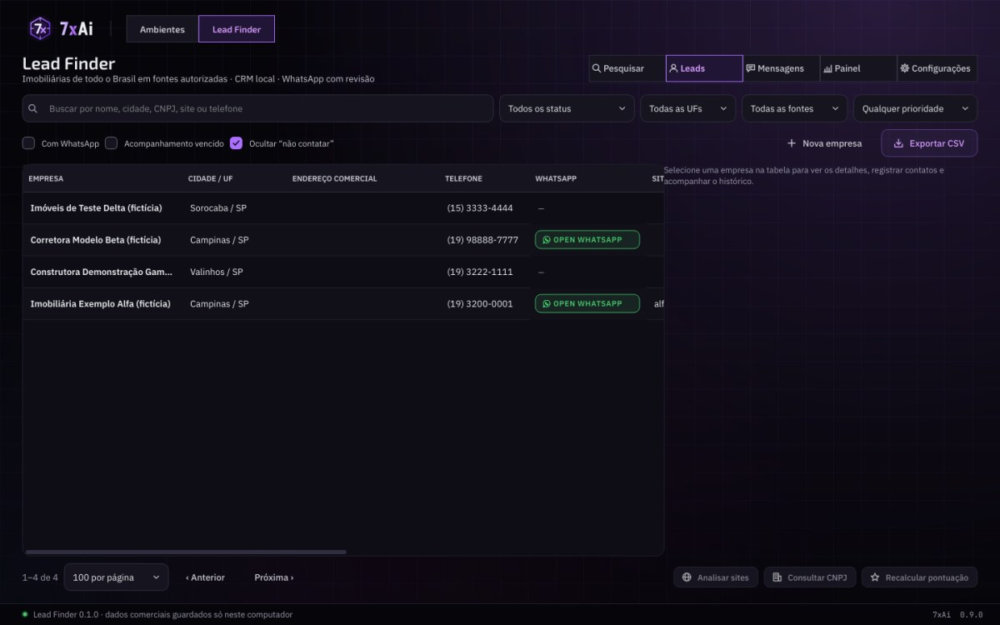
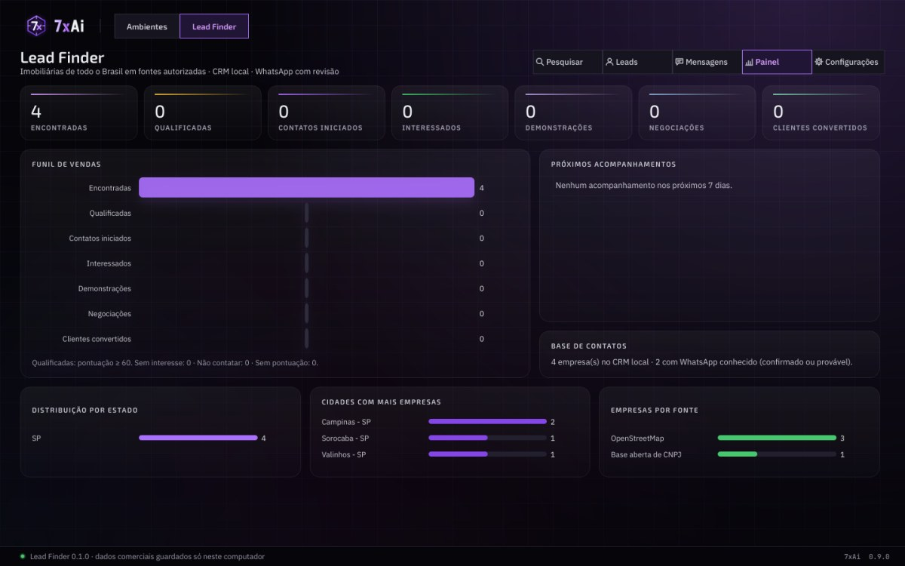

# 7xAi

[](https://github.com/tuzin7x/softwareEditor/releases/latest)
[](https://github.com/tuzin7x/softwareEditor/actions/workflows/tests.yml)
[](https://github.com/tuzin7x/softwareEditor/actions/workflows/build-windows.yml)
-0078D4)

### [⬇ Baixar a última versão do 7xAi para Windows](https://github.com/tuzin7x/softwareEditor/releases/latest)

O **7xAi** é um programa para Windows feito para o **mercado imobiliário**. Ele reúne duas ferramentas numa
mesma janela:

- **AI Studio (aba "Ambientes"):** a partir de **uma única foto** de um imóvel, gera novas versões do mesmo
  ambiente, com móveis, materiais e estilo novos, e monta um **vídeo "antes e depois"** para as redes sociais.
  Roda **no computador do usuário**, na placa de vídeo NVIDIA; a foto não sai do PC.
- **Lead Finder (aba "Lead Finder"):** encontra imobiliárias, corretoras e construtoras em **fontes autorizadas**,
  organiza os contatos comerciais num **CRM local** e prepara o primeiro contato pelo **WhatsApp**, sempre com
  revisão e envio feitos pela pessoa.

> **Estado do projeto (18/11/2026):** a primeira versão oficial proposta é a **0.9.0**, ainda em **rascunho**
> (aguarda os testes do dono no Windows; ver [`CHANGELOG.md`](CHANGELOG.md)). Enquanto não houver uma Release
> publicada, o link "Baixar a última versão" mostra uma página vazia; os executáveis de teste ficam nos artefatos
> do workflow [Build Windows](https://github.com/tuzin7x/softwareEditor/actions/workflows/build-windows.yml).



## Para que serve

| Quem | Como usa o 7xAi |
|---|---|
| Corretor ou imobiliária | transforma a foto de um imóvel vazio ou desatualizado em versões mobiliadas e decoradas, e publica o vídeo antes e depois em Reels, Stories e portais |
| Construtora e incorporadora | mostra o potencial de unidades vazias ou de fachadas, e cria decorações temáticas para lançamentos |
| Quem vende serviços para o setor | encontra imobiliárias por estado ou cidade, qualifica cada uma e organiza o contato comercial no CRM |

## AI Studio — redesenho de ambientes por IA


<sub>Foto de exemplo: "Stafford interior", Aimcotest, Wikimedia Commons, CC BY-SA 3.0.</sub>

| Função | O que faz |
|---|---|
| Mudar estilo | mesma sala e mesma arquitetura, com móveis e decoração em outro estilo |
| Reforma completa | troca também pisos, revestimentos e acabamentos |
| Redesign simples | mudança leve, que mantém a sala reconhecível |
| Mobiliar ambiente vazio | mobília completa numa sala vazia |
| Editar área | o usuário pinta uma região e só ela muda; o resto fica idêntico à foto |
| Fachada | redesenho da parte externa do imóvel |
| Decoração de evento | aniversário, casamento, Natal, festa infantil, chá de bebê e réveillon |
| Texto para ambiente | cria um ambiente a partir de uma descrição, sem foto |
| Ampliar 4K | a versão escolhida sai com 3840 px |
| Vídeo antes e depois | a foto original se transforma nas versões novas, com movimento de câmera lento, em 16:9 (1920×1080) ou 9:16 (1080×1920) |

- 14 estilos (moderno, contemporâneo, escandinavo, minimalista, industrial, clássico, luxo, boho, japandi, rústico,
  costeiro, tropical brasileiro, mid-century e fazenda moderna) e 8 tipos de ambiente.
- Cada pedido gera até 4 versões. Janelas e portas originais são recolocadas por cima da imagem gerada, e um
  controle automático descarta as versões fracas.
- **Modos legados** (botão "Avançado (vídeo de montagem, legado)"): vídeos de montagem da versão anterior do
  produto. No **modo A**, móveis 3D entram numa foto vazia; no **modo B**, a foto mobiliada vira sala vazia e os
  móveis da própria foto entram um a um. Continuam disponíveis, mas não são o fluxo principal.

**Desempenho medido:** cerca de 8 a 11 s por imagem numa RTX 5070 Laptop de 8 GB, num teste isolado do motor (com
os codificadores de texto na CPU para caber em 8 GB). O programa completo ainda não foi medido no Windows.

**Limitações conhecidas (versão 0.9.0):**

- "Editar área" às vezes deixa uma mancha oval no lugar do móvel novo;
- a proteção de janelas e portas falha em aberturas pequenas ou parcialmente cobertas;
- "Mudar estilo" muda pouco em salas que já estão decoradas;
- "Reforma completa" mantém a disposição original dos móveis;
- "Mobiliar ambiente vazio" às vezes cria vigas no teto ou erra a escala dos móveis;
- o vídeo antes e depois coloca faixas laterais em fotos 4:3.

## Lead Finder — prospecção de imobiliárias



| Recurso | O que faz |
|---|---|
| Pesquisar | Brasil, região, estados ou vários municípios (lista oficial do IBGE); 17 palavras-chave do setor + palavras próprias; estimativa de custo antes de começar; andamento ao vivo e cancelamento |
| Fontes | OpenStreetMap/Overpass (gratuita, sem chave); base aberta de CNPJ da Receita Federal (o usuário baixa os arquivos oficiais e o 7xAi importa só empresas ativas do setor); BrasilAPI (consulta de um CNPJ); Google Places API (opcional, paga, **com chave do próprio usuário**, limites por pesquisa e por mês). Nenhuma raspagem de sites, portais ou redes sociais |
| Consolidação | a mesma empresa vinda de várias fontes vira um registro só (CNPJ, telefone, site ou nome + cidade), com a origem e a data de cada dado |
| Leads | tabela paginada com busca, filtros, ordenação e exportação CSV (com atribuição das fontes; dados do Google ficam fora) |
| WhatsApp | número normalizado pelas regras da Anatel e mensagem personalizada e editável, aberta em `wa.me`. **Nada é enviado automaticamente**: o CRM registra "WhatsApp aberto" e só marca "Mensagem enviada" quando a pessoa confirma |
| CRM local | 9 status, histórico, notas, lembretes, prioridade e "Não contatar" com lista de supressão (a empresa não volta em pesquisas futuras) |
| Qualificação | pontuação de 0 a 100 com justificativa por critério; análise opcional da página principal do site oficial, respeitando o `robots.txt` |
| Painel | funil, indicadores, estados, cidades, fontes e próximos acompanhamentos, calculados do banco local |
| Mensagens | modelos prontos (profissional e direto) e, opcionalmente, variação por IA com chave própria do usuário e limite diário |
| AI Studio | vincula um projeto, imagem ou vídeo do AI Studio a uma empresa (só leitura dos trabalhos) |




**O que já foi verificado e o que não foi:**

| Item | Situação |
|---|---|
| IBGE (municípios) e BrasilAPI (CNPJ) | consultados ao vivo durante o desenvolvimento |
| OpenStreetMap/Overpass | a consulta foi aceita por um servidor Overpass público; o servidor padrão (`overpass-api.de`) recusou o ambiente de nuvem do desenvolvimento. **Falta testar no PC do usuário** |
| Google Places | implementado pela documentação oficial e testado **só com respostas gravadas** (sem chave real) |
| Variação de mensagem por IA | testada **só com respostas gravadas** (sem chave real) |
| WhatsApp | link `wa.me` e fluxo testados na interface, **sem abrir** o WhatsApp de verdade |
| Importação da base de CNPJ | testada com um arquivo sintético no formato oficial, não com os arquivos completos da Receita |

O Lead Finder usa a internet: nessa aba o selo "Processado no seu computador" não aparece. Os dados ficam só no
computador do usuário, em `%LOCALAPPDATA%\MobiliaStudio\lead_finder`. Detalhes, custos e LGPD:
[`docs/LEAD_FINDER.md`](docs/LEAD_FINDER.md).

## Instalar (usuário final)

1. Abra a [última versão](https://github.com/tuzin7x/softwareEditor/releases/latest) e baixe
   **`7xAI-Setup-vX.Y.Z.exe`**.
2. Dê dois cliques e siga as telas. Não precisa de administrador; o atalho **7xAi** aparece na Área de Trabalho.
3. Se o Windows mostrar "O Windows protegeu o computador" (o programa ainda não tem assinatura digital paga),
   clique em **Mais informações → Executar assim mesmo**.
4. No primeiro uso, o 7xAi baixa e instala o motor de IA uma única vez (ver requisitos abaixo).

Prefere não instalar? Baixe **`7xAI-Portable-vX.Y.Z.exe`** e abra direto (abre alguns segundos mais devagar). Para
conferir que o download não foi alterado, compare o SHA-256 do arquivo com o `SHA256SUMS.txt` da mesma página
(`Get-FileHash .\7xAI-Setup-vX.Y.Z.exe` no PowerShell).

### Requisitos do sistema

| Item | Requisito |
|---|---|
| Sistema | Windows 10 ou 11, 64 bits |
| Placa de vídeo | NVIDIA com 8 GB de memória de vídeo (recomendado; driver 580 ou mais novo). Sem GPU NVIDIA o AI Studio roda em modo CPU, muito mais lento |
| Primeiro uso | internet para baixar o motor: cerca de **12 GB** no total, dos quais **~7,5 GB** são os pesos do redesenho (SDXL Lightning, codificadores de texto, VAE, ControlNet e ampliador 4x; tamanhos em [`docs/LICENCAS_V3.md`](docs/LICENCAS_V3.md)), mais PyTorch com CUDA e os modelos de análise. Deixe folga no disco (por exemplo, 25 GB livres) |
| Depois | o AI Studio funciona sem internet; o Lead Finder precisa de internet para pesquisar |

O motor fica em `%LOCALAPPDATA%\MobiliaStudio` (nome antigo mantido de propósito, para reaproveitar um motor já
instalado) e é reaproveitado entre atualizações.

## Tecnologias

| Parte | Tecnologia |
|---|---|
| Interface | Python 3.13, PySide6 (Qt 6), fontes Inter |
| AI Studio | PyTorch (CUDA), diffusers (SDXL Lightning + ControlNet de profundidade), Real-ESRGAN x4, MoGe-2 e OneFormer (análise da foto), FFmpeg (H.264) |
| Modos legados | Blender `bpy` (Cycles), SAM 2.1 e big-lama |
| Lead Finder | só biblioteca padrão do Python (`urllib`, `sqlite3`, `csv`, `zipfile`) + PySide6 |
| Empacotamento | PyInstaller (programa leve, só a interface) + Inno Setup (instalador); motor instalado no primeiro uso |
| CI/CD | GitHub Actions: testes, build do Windows e Release oficial com SHA-256 |

Só são usados modelos de IA com licença que permite uso comercial: [`docs/LICENCAS_V3.md`](docs/LICENCAS_V3.md).

## Arquitetura modular

```
7xAi.exe (PySide6, só interface)
├── MainWindow (mobilia/ui/app.py)
│   ├── aba "Ambientes" = AI Studio ──► motor em processo separado: python -m mobilia.cli <comando> --json
│   │                                     (mobilia/design, mobilia/video, modos legados)
│   └── abas de módulos ◄── mobilia/ui/modules.py (registro) ◄── mobilia/modules/<módulo>/__init__.py
│                            └── Lead Finder (mobilia/modules/lead_finder): SQLite e rede em threads próprias
└── instalação do motor no primeiro uso (mobilia/bootstrap.py)
```

- Cada módulo em `mobilia/modules/` se registra sozinho com um `ModuleSpec` (id, título, página criada só na
  primeira abertura, `local=False` quando usa a internet). Um módulo com erro é ignorado e a janela abre igual.
- A interface nunca importa numpy, PIL, torch ou cv2 (testado), por isso o `.exe` é leve.
- Nenhum acesso a banco ou rede roda na thread da interface.

Detalhes: [`docs/ARQUITETURA.md`](docs/ARQUITETURA.md) (seções 11 a 14) e
[`docs/PARALLEL_DEVELOPMENT.md`](docs/PARALLEL_DEVELOPMENT.md) (como criar um módulo).

## Desenvolvimento

```bash
git clone https://github.com/tuzin7x/softwareEditor.git && cd softwareEditor
python3.13 -m venv .venv && . .venv/bin/activate        # Windows: py -3.13 -m venv .venv; .venv\Scripts\activate
pip install -r requirements/dev.txt                      # interface + motor (PyTorch CPU) + pytest
pip install --no-deps -r requirements/runtime-nodeps.txt # MoGe-2 (análise da foto)
python -m mobilia.ui.app                                 # abre a janela
python -m mobilia.modules.lead_finder                    # só o Lead Finder, numa janela própria
```

Para só a interface e o Lead Finder bastam `PySide6==6.12.0` e `pytest`. Linha de comando do motor:

```bash
python -m mobilia.cli hardware
python -m mobilia.cli design --photo sala.jpg --funcao mudar_estilo --estilo japandi --ambiente sala --n 4 --out-dir saida/
python -m mobilia.cli ampliar --image saida/<versão>.jpg --out saida/<versão>_4k.jpg
python -m mobilia.cli showcase --before saida/antes.jpg --after saida/<versão1>.jpg --out antes_depois.mp4 --format 9x16
python -m mobilia.cli run --photo sala.jpg --room sala --out montagem.mp4     # modo legado A/B
```

`MOBILIA_HOME=<pasta>` troca a pasta de dados (útil em testes).

### Testes

```bash
QT_QPA_PLATFORM=offscreen python -m pytest -q -m "not slow and not models and not gpu"   # suíte rápida (a do CI)
QT_QPA_PLATFORM=offscreen python -m pytest -q tests/lead_finder tests/test_modules.py tests/test_ui.py
```

No PowerShell: `$env:QT_QPA_PLATFORM = "offscreen"` antes do `pytest`. Marcadores (`pyproject.toml`): `slow`
(render ou modelos em CPU), `models` (pesos dos modelos) e `gpu` (placa NVIDIA). O CI
([`tests.yml`](.github/workflows/tests.yml)) roda a suíte rápida inteira de `tests/`, com dependências de versão
fixa ([`packaging/ci/requirements-tests.txt`](packaging/ci/requirements-tests.txt)) e `pip check`; testes que
precisam do PyTorch e de outras bibliotecas pesadas são pulados ali.

### Gerar o `.exe`

- **No Windows:** instale o [Python 3.13](https://www.python.org/downloads/) (marque *Add python.exe to PATH*) e dê
  dois cliques em **`GERAR_EXE.bat`**. Ele chama `packaging/build_windows.ps1`, que gera `dist\7xAi\7xAi.exe` com
  `packaging/7xai.spec`, roda o autoteste (`7xAi.exe --selftest`), instala em `%LOCALAPPDATA%\Programs\7xAi` e cria
  o atalho. Com o [Inno Setup 6](https://jrsoftware.org/isdl.php) instalado, também gera o instalador.
- **No GitHub Actions:** o workflow [Build Windows](.github/workflows/build-windows.yml) roda a cada push em
  `claude/**`, `feature/**` e `main` (ou manualmente em *Run workflow*) e guarda o programa e o instalador **só como
  artefatos** da execução; ele nunca publica Release.
- **Versão oficial:** só pelo workflow [Release oficial](.github/workflows/release.yml), disparado à mão a partir
  da `main`. Ele testa, gera instalador e portátil, abre cada um em autoteste, calcula o SHA-256 e publica a
  Release com a tag `vX.Y.Z`. Passo a passo: [`docs/RELEASES.md`](docs/RELEASES.md).

## Estrutura do repositório

| Caminho | Conteúdo |
|---|---|
| `mobilia/design/`, `mobilia/video/` | motor do AI Studio: redesenho, trava de janelas e portas, ampliar 4K, vídeo antes e depois |
| `mobilia/ui/` | interface PySide6: janela principal, modo legado, tema, registro de módulos (`modules.py`) |
| `mobilia/modules/lead_finder/` | módulo Lead Finder (fontes, banco, CRM, interface) |
| `mobilia/analysis/`, `layout/`, `render/`, `composite/`, `removal/`, `layers2d/`, `gen/` | modos legados A e B |
| `mobilia/cli.py`, `runtime.py`, `bootstrap.py` | linha de comando, pastas e worker, instalação do motor no primeiro uso |
| `tests/`, `tests/lead_finder/` | testes (rápidos, `slow`, `models` e `gpu`) |
| `requirements/` | dependências do motor (vão dentro do `.exe` para a instalação no primeiro uso) |
| `packaging/`, `GERAR_EXE.bat` | `.spec` do PyInstaller, instalador Inno Setup, ícones e dependências fixas do CI (`packaging/ci/`) |
| `.github/workflows/`, `scripts/release_notes.py` | testes, builds de desenvolvimento e Release oficial |
| `docs/` | arquitetura, Lead Finder, releases, licenças, limitações, planos e provas de conceito (`docs/poc/`) |

## Documentação

- [`CHANGELOG.md`](CHANGELOG.md): histórico de versões.
- [`docs/RELEASES.md`](docs/RELEASES.md): como publicar uma versão oficial, versionamento e como voltar atrás.
- [`docs/ARQUITETURA.md`](docs/ARQUITETURA.md): arquitetura do AI Studio, da interface, dos módulos, do
  Lead Finder, das releases e dos modos legados.
- [`docs/LEAD_FINDER.md`](docs/LEAD_FINDER.md): o Lead Finder em detalhe (fontes, WhatsApp, CRM, custos, LGPD).
- [`docs/PARALLEL_DEVELOPMENT.md`](docs/PARALLEL_DEVELOPMENT.md): como desenvolver um módulo em paralelo.
- [`RESUME.md`](RESUME.md): estado atual e como retomar o trabalho.
- [`docs/LICENCAS_V3.md`](docs/LICENCAS_V3.md): licenças dos modelos e assets.
- [`docs/LIMITACOES.md`](docs/LIMITACOES.md): limitações dos modos legados.
- Histórico de pesquisa e planos: [`docs/PESQUISA_TECNOLOGIAS.md`](docs/PESQUISA_TECNOLOGIAS.md),
  [`docs/PLANO_V2.md`](docs/PLANO_V2.md), [`docs/PLANO_V3.md`](docs/PLANO_V3.md), `docs/pesquisa_bruta/`,
  `docs/relatorios_agentes/` e `docs/poc/`.

## Branches

- **`main`**: versões aprovadas pelo dono; as Releases oficiais saem daqui.
- **`claude/sweet-bohr-4uzml2`**: branch de integração (desenvolvimento). Módulos novos chegam por Pull Request
  de branches `feature/<nome>`.
- Sem force-push e sem reescrever o histórico.

## Licenças e dados

- Este repositório não tem um arquivo de licença de código aberto: o código não é licenciado para reuso.
- Modelos de IA: só licenças comerciais ([`docs/LICENCAS_V3.md`](docs/LICENCAS_V3.md)), baixados no primeiro uso e
  nunca guardados no repositório.
- Assets 3D do modo legado: Poly Haven (CC0) e assets procedurais próprios. Blender/bpy (GPL) roda num processo
  separado. FFmpeg: GPL, build com x264. Fontes Exo 2, IBM Plex Sans e JetBrains Mono: SIL OFL 1.1
  (`mobilia/ui/fonts/OFL-*.txt`), arquivos do repositório google/fonts. Identidade visual (cores, emblema 7x)
  compartilhada com o site 7x Intelligence, do mesmo dono.
- As fotos de `tests/fixtures/photos` são CC BY-SA (ver
  [`tests/fixtures/photos/ATRIBUICOES.md`](tests/fixtures/photos/ATRIBUICOES.md)) e servem só para testes e
  exemplos. As capturas de tela em `docs/img/` foram geradas do programa real, com dados fictícios.
- **Fotos e dados de clientes nunca entram no repositório.** O `.gitignore` bloqueia `usuario_*`, `.env`, chaves e
  bancos locais; chaves de API do Lead Finder ficam só na pasta de dados do usuário.
